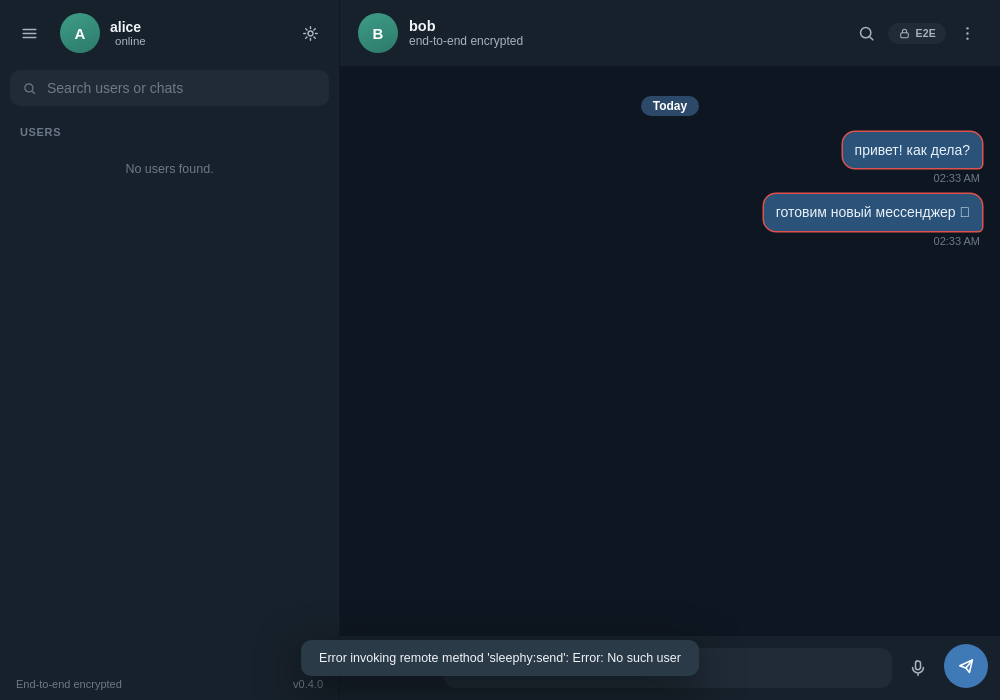
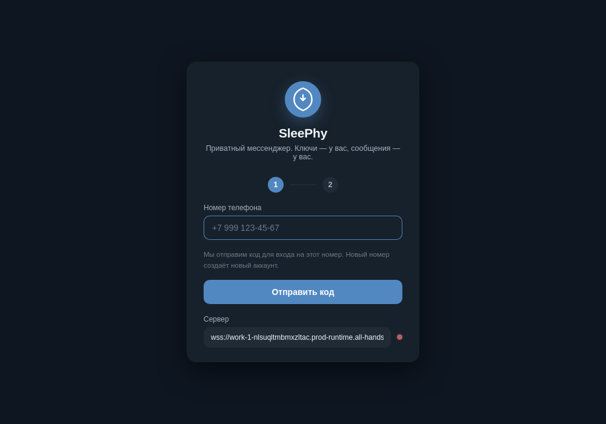
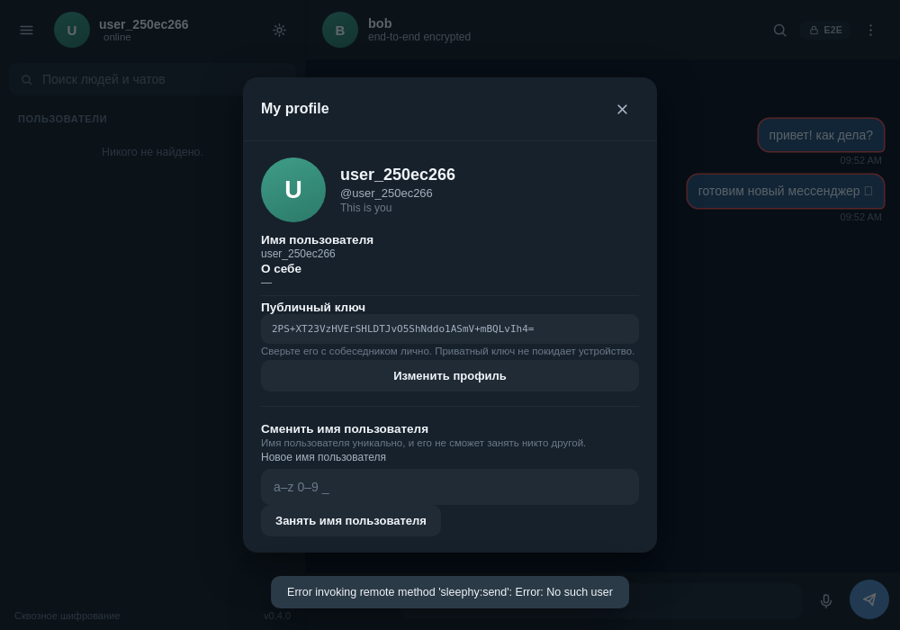
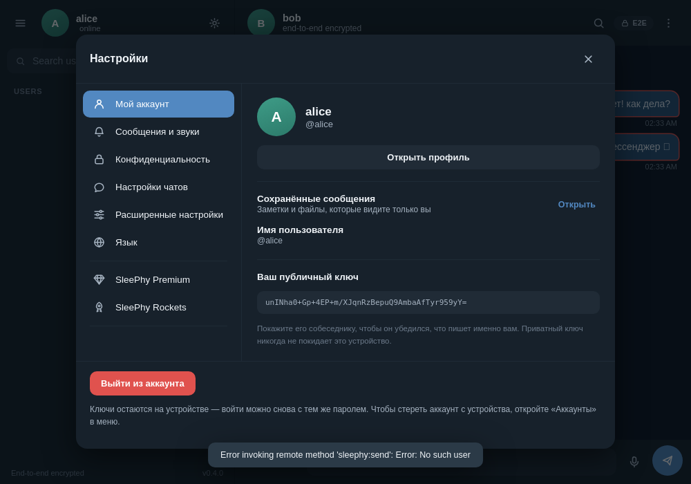
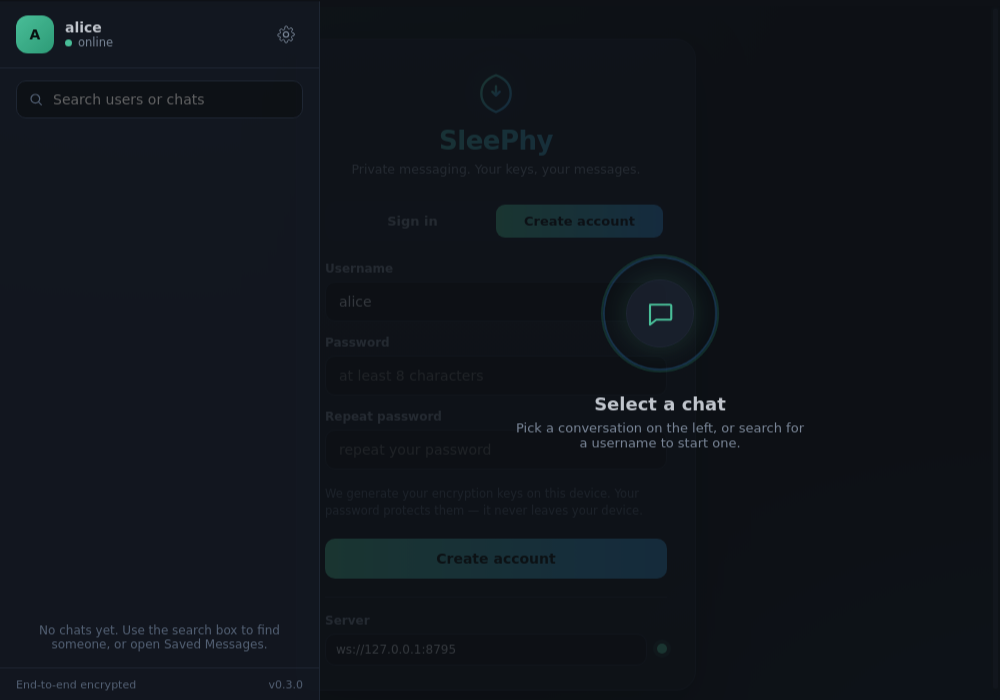
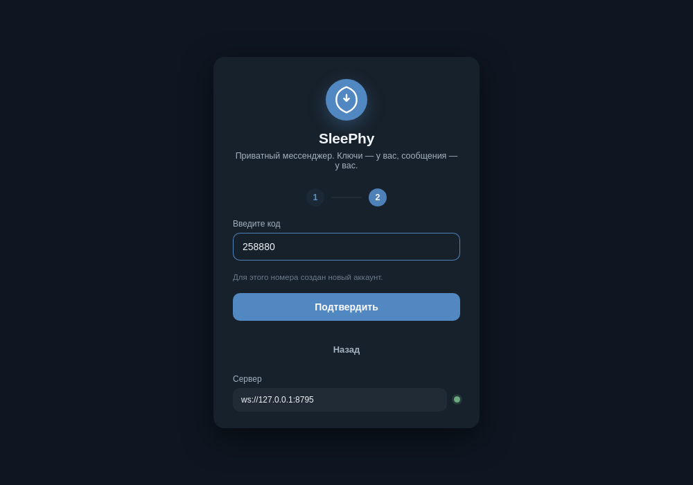

# SleePhy

**Десктопный мессенджер с настоящим сквозным шифрованием.** Сервер — «слепой»
релей: он хранит и пересылает только шифротекст, который не может прочитать.

[](#download)
[](https://doc.libsodium.org/)
[](LICENSE)
[](https://github.com/lauzent-team/belka-vpn/releases/latest)

<a id="download"></a>

## ⬇️ Скачать

| Сборка | Файл | Как поставить |
| --- | --- | --- |
| **Windows 10/11 (x64)** | [**SleePhy-Setup-0.16.13.exe**](https://github.com/lauzent-team/belka-vpn/releases/latest/download/SleePhy-Setup-0.16.13.exe) | Запустить установщик, дальше — как обычную программу |
| Linux | `npm run dist:linux` → AppImage | См. [сборку из исходников](#run-it-locally) |

Установщик уже настроен на рабочий релей: **ничего вводить не нужно**, только
придумайте логин и пароль. Пароль шифрует ваши ключи на этом устройстве и
никуда не отправляется.



## Почему SleePhy

- 🔐 **Ключи рождаются на вашем устройстве.** Приватный ключ шифруется паролем
  и лежит в `sleephy-identity.json` (`0600`). Он не покидает машину.
- 🙈 **Сервер слепой.** Переписка уходит в релей шифротекстом; в базе сервера
  нет ни одного открытого слова. Тесты это проверяют напрямую.
- 🧮 **Без самодельной криптографии.** Всё на [libsodium](https://doc.libsodium.org/):
  X25519, `crypto_box` (XSalsa20-Poly1305), scrypt.
- 🖥️ **Настольное приложение.** Electron, нативные установщики для Windows и
  Linux — не вкладка в браузере.
- 🧭 **Честный список того, чего пока нет** — ниже, в разделе
  [«Что ещё не сделано»](#what-is-not-done-yet). Проект не выдаёт себя за более
  защищённый, чем он есть.

## Что уже работает

**Аккаунты и профили**

- Регистрация и вход по логину и паролю; пароль защищает ключи на устройстве
- **Уникальный @username** — можно занять и менять в любой момент
- **Один компьютер — до трёх аккаунтов** (с Premium — до пяти). Лимит считает
  релей по идентификатору установки; чтобы завести ещё один, освободите слот
- Профиль: имя, био, цвет аватара и **соцсети** (Telegram, Instagram, X, GitHub…)
  отдельными чипами
- **Приватность, которую держит релей**: скрыть время последнего визита и
  скрыть профиль от всех, кроме себя

**Переписка**

- Поиск людей по username и старт чата
- Текст с **E2E-шифрованием** — релей не видит открытый текст
- **Избранное** — заметки самому себе, читает только владелец
- **Ответы** с цитатой, **редактирование** и **удаление** своих сообщений
- **Реакции** (👍 ❤️ 😂 🔥 😮 😢), **индикатор набора** и **онлайн-статус**
- **Огонёк** — счётчик дней подряд, что вы писали друг другу
- **Самоуничтожающиеся сообщения** — таймер на чат, каждый пузырь с обратным
  отсчётом; релей стирает шифротекст по истечении
- **Отложенные сообщения** — «отправить позже», релей держит шифротекст до часа
  отправки
- **Проверка ключей (safety number)** — двенадцать групп цифр из обоих публичных
  ключей; одинаковы на обоих концах и никогда не идут на сервер
- Доставка офлайн-сообщений при переподключении, история по дням, черновики

**Группы, каналы и прочее**

- **Групповые чаты** со списком участников и именами на пузырях
- **Каналы** — вещание «один-ко-многим», можно находить и подписываться
- **Боты** и **мини-игры** (крестики-нолики, морской бой) прямо в чате
- **Подарки** — коллекция: подарок приходит в инвентарь, его можно поставить на
  профиль или продать обратно за ракеты
- **Опросы**, **сторис** (24 часа, у каждого зрителя своя шифрованная копия)

**Ракеты и Premium**

- **SleePhy Rockets** — внутренняя валюта фиксированными наборами; цены держит
  релей, пополнение зачисляется ровно один раз на подтверждение провайдера
- **SleePhy Premium** — подписка на месяц; повторная покупка **продлевает**, а не
  начинает заново; с ней лимит аккаунтов на устройстве поднимается с трёх до пяти

**Админ-панель**

- Статистика по пользователям, каналам, **устройствам** и подпискам Premium
- Управление аккаунтами, каналами, объявлениями и журналом действий
- Вкладка **«Устройства»** — видно, сколько аккаунтов завёл каждый компьютер, и
  можно освободить слоты устройства, не удаляя сами аккаунты

**Звонки и музыка**

- **Звонки** — один-на-один и групповые, аудио и видео, с демонстрацией экрана.
  Медиа идёт peer-to-peer (WebRTC); релей пересылает только рукопожатие
- **Бурмалда FM** — встроенный плеер со своей музыкой и плейлистом

**Поиск и управление чатами**

- Поиск людей и каналов, **поиск внутри чата** с фильтрами, **глобальный поиск**
  по тексту сообщений — запрос расшифровывается и ищется локально
- **Папки чатов**, закрепление, мьют, архив, непрочитанные, очистка истории
- Действия с чатом теперь в **профиле собеседника**, а не в отдельном меню

## Скриншоты

| Вход | Чат | Профиль |
| --- | --- | --- |
|  |  |  |

| Настройки | Список чатов | Код входа |
| --- | --- | --- |
|  |  |  |

## Что ещё не сделано

Честный список. Приложение не следует описывать как более защищённое, чем оно есть.

- **Нет forward secrecy.** Компрометация приватного ключа раскрывает прошлые
  сообщения. Лечится протоколом с ratchet (Double Ratchet).
- **Проверка ключей ручная.** Профиль показывает safety number, но приложение не
  заставляет сверять его до первого сообщения.
- **Метаданные видит сервер** — кто с кем, когда и какого размера сообщения.
- **Нет мультидевайса** — один ключ на аккаунт, привязан к одному устройству.
- **Звонки best-effort** — зависят от signaling-релея и ICE/STUN.
- **История живёт на сервере** (шифротекстом) до «Очистить историю».
- **Платежи не живые, пока не настроены.** Провайдер по умолчанию —
  `disabled`: покупка отклоняется, ничего не зачисляется. Реальные деньги
  двигает только настроенный YooMoney (или адаптер); демо-страница денег не берёт
  и включается отдельным флагом.
- **Аккаунт нельзя восстановить.** Потеряли пароль — потеряли ключи.


---

# SleePhy (English)

An end-to-end encrypted desktop messenger. The server is a **blind relay** — it
stores and forwards ciphertext it cannot read.

> Status: working MVP. Text messaging between two accounts works, with real
> end-to-end encryption and a real relay server. See
> [What is not done yet](#what-is-not-done-yet).

**Highlights**

- Keys are generated on your device; the private key is encrypted with your
  password and never leaves the machine.
- The relay never sees plaintext — the end-to-end test asserts the database
  contains no readable message.
- No hand-rolled cryptography: everything is [libsodium](https://doc.libsodium.org/)
  (X25519, `crypto_box`, scrypt).
- Native Windows installer and Linux AppImage.
- Accounts and profiles, replies, edits, deletes, reactions, typing and presence,
  a per-chat streak, self-destructing and scheduled messages, key verification,
  groups, channels, bots and mini-games, gifts, polls and stories, Rockets and
  Premium, audio/video calls and a built-in music player.

## How the encryption works

Everything is done with [libsodium](https://doc.libsodium.org/) — no hand-rolled
cryptography.

| Purpose | Primitive |
|---|---|
| Identity | X25519 keypair |
| Messages | `crypto_box` — X25519 + XSalsa20-Poly1305 (authenticated) |
| Private key at rest | XSalsa20-Poly1305 under a scrypt-derived key |
| Password verifier | scrypt |

Your private key is generated on your device, encrypted with your password, and
stored in `sleephy-identity.json` (permissions `0600`). It never leaves the
machine, and it is never sent to the server.

Read [ARCHITECTURE.md](ARCHITECTURE.md) for the threat model — including what is
**not** protected yet.

## Run it locally

The desktop app needs a relay to connect to. Without one, the connection
indicator stays red and you cannot create an account.

```bash
npm install

# 1. start the relay server
npm run server

# 2. in another terminal, start the app
npm start
```

The app connects to `ws://127.0.0.1:8787` by default. To point it somewhere
else, set the environment variable before starting:

```bash
SLEEPHY_SERVER=wss://your-server.example.com npm start
```

or change the address in the app under Settings → Server address.

To try a conversation, run a second copy with a separate profile:

```bash
npm start -- --user-data-dir=/tmp/sleephy-second
```

Register two accounts (for example `alice` and `bob`), then in one window type
the other username into the search box and press Enter.

## Ship a build pointed at your server

Create `server-default.json` in the project root before building:

```json
{ "server": "wss://your-server.example.com" }
```

It is bundled into the app, so the installer works out of the box with no
address to type. A per-machine environment variable (`SLEEPHY_SERVER`) still
overrides it.

## Build a Windows installer

```bash
npm run dist:win      # -> dist/SleePhy-Setup-0.16.13.exe
```

Building a Windows `.exe` from Linux/macOS uses Wine; the CI workflow does this
on a native Windows runner instead. See `.github/workflows/build.yml`.

## Your own music and ringtones

The **Бурмалда FM** player ships with a built-in broadcast, so it plays the
moment the app is installed — no setup. Opening the tab starts the station and
it repeats forever until you close the tab or quit the app.

Your own tracks take priority. The player reads from a folder beside the app's
data, so they keep working after the app is installed (an installed app's own
files are read-only):

- Windows: `%APPDATA%\SleePhy\media\fm\` and `...\media\ringtones\`
- Linux: `~/.config/SleePhy/media/fm/` and `.../media/ringtones/`

Put audio files in `media/fm/` and list them in `playlist.json`; while that list
is not empty it replaces the built-in broadcast:

```json
{ "tracks": ["night-air.mp3", { "file": "dawn.ogg", "title": "Рассвет", "artist": "Бурмалда" }] }
```

For a custom ringtone, put a file in `media/ringtones/` and name it in
`manifest.json`:

```json
{ "ringtones": { "incoming": "ring.mp3", "outgoing": "dial.mp3" } }
```

With no files the station is honestly empty ("тишина в эфире") and calls use a
built-in chime, so nothing is broken by a missing folder.

## Tests

```bash
node test/e2e.js                          # real server + real crypto (11 checks)
node test/features.js                     # profiles, chats, replies (32 checks)
node test/sms-adapter.js                  # SMS delivery against a fake provider (19 checks)
xvfb-run -a node test/ui.js               # drives the real Electron UI (16 checks)
xvfb-run -a node test/ui-features.js      # the new features, clicked for real (22 checks)
xvfb-run -a node test/ui-drafts.js        # drafts survive a restart (5 checks)
xvfb-run -a node test/ui-polls.js         # polls voted on by two devices (11 checks)
xvfb-run -a node test/ui-folders.js       # chat folders, tabs and restart (7 checks)
xvfb-run -a node test/ui-chatsearch.js    # in-chat search filters (9 checks)
xvfb-run -a node test/ui-bots-games.js    # a game and a gift over the relay
xvfb-run -a node test/connection.js       # connection and error handling (4 checks)
node test/folders.js                      # folder filter rules (12 checks)
node test/polls.js                        # poll encode, validate, tally (12 checks)
node test/games.js                        # game rules (21 checks)
node test/chatsearch.js                   # in-chat search filter rules (18 checks)
node test/globalsearch.js                 # global search rules (15 checks)
node test/globalsearch-relay.js           # global search over a real relay (10 checks)
xvfb-run -a node test/ui-globalsearch.js  # the "Сообщения" section, clicked for real (6 checks)
node test/ttl.js                          # self-destructing messages over the relay (8 checks)
node test/scheduled.js                    # scheduled messages over the relay (10 checks)
xvfb-run -a node test/ui-ttl.js           # the auto-delete timer, clicked for real (8 checks)
xvfb-run -a node test/ui-scheduled.js     # "send later" picker and list, clicked for real (9 checks)
node test/safety.js                       # safety numbers: both ends agree, per pair (8 checks)
xvfb-run -a node test/ui-safety.js        # the safety number in the profile, clicked for real (6 checks)
node test/calls-logic.js                  # call labels, ringtone choice, participant text (15 checks)
node test/calls.js                        # call signaling over a real relay (13 checks)
xvfb-run -a node test/ui-calls.js         # real calls and the FM station, clicked for real (12 checks)
node test/fm-logic.js                     # playlist, shuffle and repeat rules (17 checks)
node test/premium-logic.js                # Rocket prices, Premium expiry math (11 checks)
node test/payments.js                     # Rockets, Premium and gifts over a real relay (15 checks)
xvfb-run -a node test/ui-premium.js       # the Rockets and Premium panes, clicked for real (8 checks)
```

The end-to-end suite verifies, among other things, that the plaintext never
appears in the server database and that tampered ciphertext is rejected.

## Running your own server

The relay is a single Node.js process with SQLite storage:

```bash
SLEEPHY_PORT=8787 SLEEPHY_DB=/var/lib/sleephy/sleephy.db node server/index.js
```

Put it behind TLS (`wss://`) in production — the app accepts any WebSocket URL
in Settings → Server address. The relay listens on `$PORT` when `SLEEPHY_PORT`
is unset, so a platform host can place it; `SLEEPHY_PORT` always wins.

For a step-by-step deployment on a real server — service units, a Caddy config
that gets the certificate for you, and a Russian-language guide that covers the
no-foreign-card case — see [`deploy/oracle/`](deploy/oracle/README.md).

To run the relay on a free container host instead, there is a Dockerfile and an
Amvera config in [`deploy/free/`](deploy/free/README.md). That guide is also in
Russian and starts with the arithmetic: a relay needs ~73 vCPU-hours and ~183
GB-hours a month, which is why most "free" tiers cannot keep it up 24/7.

### Sending login codes by SMS (not enabled)

Sign-in is by username and password, so nothing here is needed for the app to
work. This is the phone flow, kept ready for when an SMS provider is paid for.
The button on the sign-in screen stays disabled until then.

The flow is phone plus a one-time code, so the relay needs a way to deliver that
code. Without a provider it prints the code to its own log, which is fine for
development and useless for real users.

The relay only knows how to POST `{ phone, code }` as JSON to one URL
(`SLEEPHY_SMS_WEBHOOK`). Providers do not speak that shape, so a small adapter
translates between them and adds the throttling the relay does not have:

```
relay ──{phone,code}──▶ sms-adapter ──provider API──▶ SMS gateway
```

1. Get an account with a provider and an API key. For SMS.ru that is `api_id`
   on the dashboard; the endpoint is `https://sms.ru/sms/send`.
2. Start the adapter next to the relay, with the key in the environment:

```bash
SMSRU_API_ID=your-api-id SMS_ADAPTER_TOKEN=$(openssl rand -hex 16) \
  node server/sms-adapter.js
```

3. Point the relay at it and restart the relay:

```bash
SLEEPHY_SMS_WEBHOOK=http://127.0.0.1:8790/send/your-token node server/index.js
```

4. Sign in with a real number and confirm the message arrives.

The adapter listens on `127.0.0.1` only and is not meant to be exposed. Its
limits are deliberately low, because **every `phone.request` costs money and the
relay has no rate limiting of its own** — anyone who can reach the relay could
otherwise drain the balance by requesting codes in a loop:

| Variable | Default | Meaning |
| --- | --- | --- |
| `SMS_MIN_INTERVAL` | 60 | seconds between codes to one number |
| `SMS_PER_HOUR` | 3 | codes to one number per hour |
| `SMS_PER_DAY` | 5 | codes to one number per day |
| `SMS_DAILY_CAP` | 500 | codes to all numbers per day |

A refused request is logged and answered with `429`; the relay logs the failure
and the user sees the normal "try again" path. Set `SMS_TEXT` to change the
message (`{code}` is replaced), or `SMS_PROVIDER=generic` with
`SMS_GENERIC_URL` to use a different gateway. `test/sms-adapter.js` covers all of
this against a fake provider, so it runs without sending anything.

### Taking payment for Rockets and Premium

Out of the box the relay **refuses a purchase**: with no provider configured it
reports `disabled` and `pay.create` answers with an error, so nobody can take
Premium or Rockets for free. `mock` (a top-up that settles instantly, no money)
exists for the tests. For real money the relay talks to the same kind of adapter
as the SMS flow, so the provider secret never reaches the relay or the app:

```
app ──pay.create──▶ relay ──{id,amount}──▶ pay-adapter ──provider──▶ YooMoney
   ◀──checkoutUrl──           ◀──checkoutUrl──
app ──opens the link in the system browser──▶ provider
provider ──notify──▶ pay-adapter ──▶ relay settles the payment once
```

The relay decides every price from its own table (`SLEEPHY_ROCKET_PRICE_KOPECKS`,
`SLEEPHY_PREMIUM_PRICE_KOPECKS`, and the fixed bundle list). The adapter only
carries the amount and checks that the provider confirms the same figure; a
confirmation for a different amount is refused, and a payment is credited
exactly once.

```bash
YOOMONEY_RECEIVER=your-wallet-id YOOMONEY_SECRET=your-notify-secret \
  PAY_PROVIDER=yoomoney PAY_ADAPTER_TOKEN=$(openssl rand -hex 16) \
  node server/pay-adapter.js

SLEEPHY_PAY_PROVIDER=yoomoney \
SLEEPHY_PAY_ADAPTER=http://127.0.0.1:8791 \
SLEEPHY_PAY_ADAPTER_TOKEN=your-token \
  node server/index.js
```

The relay appends `/create`, `/verify` and the token itself, so the adapter
address is the bare host — putting the token in `SLEEPHY_PAY_ADAPTER` as well
would make the relay ask for `/your-token/create`, which the adapter does not
serve. The token is one value: the same one you pass to `PAY_ADAPTER_TOKEN`.

Tell YooMoney to notify `https://<public-host>/notify/<your-token>`. Set
`SLEEPHY_PAY_PUBLIC_URL=https://<public-host>` so the return URL after payment
points back at the relay. `SLEEPHY_WELCOME_ROCKETS=0` switches off the sign-up
grant, or change its size. `test/payments.js` covers the path against the mock
provider — forged bundles, double credits, gifting without paying and spending
more than you hold are all refused; `test/pay-adapter.js` covers the adapter
itself and `test/pay-flow.js` the relay-and-adapter handshake.

### Single-process hosts (Amvera): the relay talks to YooMoney itself

A host that runs **only** the relay — the Amvera container, whose `amvera.yaml`
starts a single process — has no adapter to reach, so the adapter route above
cannot be used. For that case the relay speaks to YooMoney directly: with
`SLEEPHY_PAY_PROVIDER=yoomoney` and the wallet configured, and **no**
`SLEEPHY_PAY_ADAPTER`, it builds the quickpay link itself and settles a payment
when YooMoney posts its signed notification to `/notify/<token>`.

Set these on the host (Amvera: project → «Переменные»):

| Variable | Value |
| --- | --- |
| `SLEEPHY_PAY_PROVIDER` | `yoomoney` |
| `YOOMONEY_RECEIVER` | your wallet id, e.g. `410011XXXXXXXXXX` |
| `YOOMONEY_SECRET` | the notification secret from YooMoney settings |
| `SLEEPHY_PAY_ADAPTER_TOKEN` | a long random string, the `/notify` path token |
| `SLEEPHY_PAY_PUBLIC_URL` | `https://<your-relay-host>` |
| `SLEEPHY_WELCOME_ROCKETS` | `0` to switch off the sign-up grant |

Then point YooMoney's «Уведомления» at
`https://<your-relay-host>/notify/<SLEEPHY_PAY_ADAPTER_TOKEN>`, with the HTTP
notification method, and copy the same secret into `YOOMONEY_SECRET`.

**Turning it on, step by step (Amvera):**

1. Open YooMoney → «Настройки» → «Уведомления» → «Уведомления о переводах» and
   take the **secret** shown there (in YooMoney's docs this is the "секретный
   ключ" the signature is computed with). That is `YOOMONEY_SECRET` — it comes
   from YooMoney, you do not invent it. Your wallet id (the number under your
   name, like `41001…`) is `YOOMONEY_RECEIVER`.
2. In the Amvera project open «Переменные» and add, one per row:
   `SLEEPHY_PAY_PROVIDER=yoomoney`, `YOOMONEY_RECEIVER=<wallet id>`,
   `YOOMONEY_SECRET=<secret from step 1>`, `SLEEPHY_PAY_ADAPTER_TOKEN=<a long
   random string you make up, e.g. a UUID>`,
   `SLEEPHY_PAY_PUBLIC_URL=https://<your-relay-host>`. Do **not** add
   `SLEEPHY_PAY_ADAPTER` — the relay talks to YooMoney itself here. The two
   secrets are different things: `YOOMONEY_SECRET` is YooMoney's, and
   `SLEEPHY_PAY_ADAPTER_TOKEN` is only the password that guards your `/notify`
   URL — it never leaves your host and YooMoney never sees it.
3. In YooMoney's «Уведомления», set the URL to
   `https://<your-relay-host>/notify/<the same token>`, method **HTTP**, and
   enable notifications.
4. Restart the container (Amvera applies variables only on restart) and check
   `https://<your-relay-host>/health` — it must say `"payments":"direct"`. If it
   says `disabled`, a variable is missing or misspelled.
5. Buy something small yourself and confirm the Rockets or Premium land. The
   admin panel banner should read «Оплата включена: YooMoney».

If `/health` says `disabled` after this, the wallet or the secret did not reach
the relay — fix that before telling anyone the shop is open.

### Payments are off until you configure them

A relay that is simply unconfigured takes **no** money and credits **nothing**:
`payMode()` returns `disabled`, `pay.create` is refused, and the app tells the
user payment is not set up on this server. This is deliberate — an unconfigured
relay must never hand out free Premium or Rockets.

The built-in checkout page (`/pay/checkout`) credits a purchase the moment the
buyer presses «Оплатить», so it moves no money. It is a demo, and it is
**opt-in**: set `SLEEPHY_PAY_DEMO=1` to switch it on. Do not set it on a relay
that is open to the public. To check what a running relay is doing, call
`/health` — it answers `{"ok":true,"service":"sleephy-relay","payments":"…"}`
with `direct`, `adapter`, `checkout`, `mock` or `disabled`. The admin panel
shows the same thing as a banner above the stats.

If the wallet or the secret is missing the relay falls back to `disabled`
(not to a working demo), so a half-configured host can never take a payment it
cannot credit. `test/pay-yoomoney-direct.js` covers the real path — the link,
the signed notification, a forged signature, a short payment and a replay — and
`test/pay-disabled.js` covers the refusal. The OAuth `YOOMONEY_TOKEN` is optional
and only enables the polling fallback for a notification that never arrived.

## What is not done yet

This is an honest list. The app should not be described as more secure than it is.

- **No forward secrecy.** Compromising a private key exposes past messages. A
  ratcheting protocol (Double Ratchet) is the fix.
- **Key verification is manual.** Each profile shows a safety number derived from
  both public keys, and you can mark a contact verified, but the app does not
  force a comparison before the first message, so a substituted key is only
  caught if you check the code.
- **Metadata is visible to the server** — who talks to whom, when, and message
  sizes.
- **No multi-device support** — one key per account, tied to one device.
- **Calls are best-effort.** One-to-one and group audio/video calls work over
  WebRTC, but they rely on a signaling relay and, across the public internet, on
  ICE/STUN servers. Set them in Settings → Advanced; on one local network calls
  connect without any. Group calls are a mesh, so they get heavy past a handful
  of people.
- **Message history lives on the server** until you clear the chat. It is stored
  as ciphertext the server cannot read, and "Clear history" deletes it — but a
  copy exists on the relay until then.
- **Deleting a message leaves a tombstone** in the other person's copy so the row
  cannot be silently rewritten; the ciphertext is wiped.
- **Profiles and usernames are public metadata** — anyone can search for a
  username and see the display name, bio and avatar colour.
- **The relay has no rate limiting or abuse protection** — needed before it
  faces the public internet. The SMS adapter throttles code requests, but nothing
  yet limits messages, searches or failed logins.
- **Payments are not live out of the box.** With no provider configured the relay
  reports `disabled` and refuses a purchase, so nothing is credited for free.
  Taking real payment means running `server/pay-adapter.js` against a provider (or
  setting the direct YooMoney variables) and pointing the relay at it; `mock`
  settles instantly and is for tests only. There is no refund or chargeback flow,
  and the welcome Rocket grant is a local policy, not a paid balance.
- **Accounts cannot be recovered.** Lose the password, lose the keys.

## Layout

```
server/index.js        WebSocket relay + accounts, profiles and chats (node:sqlite)
server/sms-adapter.js  relay JSON -> provider API, with per-number throttling
server/pay-adapter.js  relay JSON -> payment provider (YooMoney/generic/mock)
src/lib/crypto.js      libsodium + scrypt helpers (main process)
src/lib/client.js      connection, identity, encryption (main process)
src/lib/calls.js       call labels, ringtone choice, participant text
src/lib/fm.js          Бурмалда FM playlist and play-order rules
src/lib/money.js       Rocket and Premium arithmetic (relay + renderer share it)
main.js                Electron main process and IPC
preload.js             the only renderer bridge (window.sleephy)
src/index.html|css|js  interface
test/                  end-to-end, feature and UI tests
```
